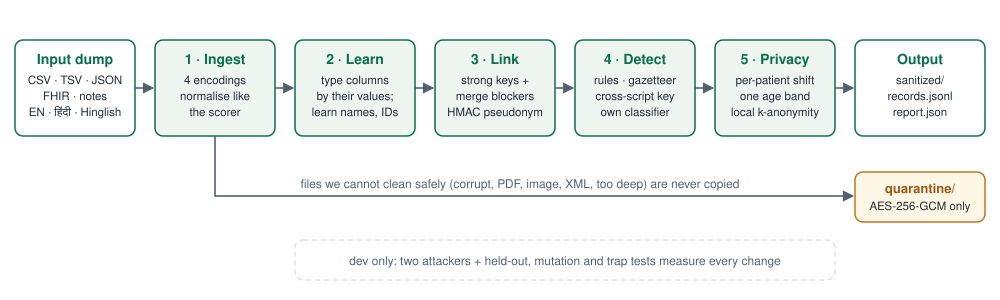

<div align="center">

# secret-ward

**Yugaantar DevForge · Track 3 · Secret Wards**

*An offline, CPU-only, LLM-free privacy firewall for English, हिंदी and Hinglish hospital records.*

[Quick start](#quick-start) · [How it works](#how-it-works) · [Built for real-world failure](#built-for-real-world-failure) · [Results](#results-at-a-glance) · [Privacy vs utility](#privacy-vs-utility-measured) · [Security](#security-design) · [Limitations](#known-limitations) · [Project brief (PDF)](docs/brief.pdf)

Team: Manav · Aditya · Nishk · Kavita

</div>

---

## The idea in one paragraph

secret-ward takes a messy multi-hospital dump (CSV, TSV, JSON, FHIR, notes, in three scripts),
removes every piece of personal data, keeps every medical value exact, and gives each real patient
one keyed fake ID across all files. **Nothing is memorised:** column meanings are read from the
*values*, not the header names, and names, places and ID numbers are learned from each new input
while it runs. That is why renamed columns, new formats and names no dictionary knows are still
caught. Privacy is not assumed: two attackers, built independently, test every change.

## Results at a glance

Practice data (`check_dev.py`), plus data we did **not** tune on:

| | Result |
|---|---|
| 🔎 Personal data leaked | **0 / 3230** (0.0% English, 0.0% Devanagari, 0.0% Hinglish; 0% in file names, keys, headers, metadata, base64) |
| 🐤 Canaries found | **0 / 4** |
| 💊 Medical values kept | **4826 / 4855 (99.4%)**. All 29 "lost" values are district names we hide on purpose; every medicine, dose, lab and diagnosis is kept |
| 📅 Date intervals / stay lengths | **15286 / 15286** pairs exact |
| 🔗 Linking precision / recall / F0.5 | **1.00 / 1.00 / 1.00**, 0 wrong merges |
| 🛡️ Patients unique on what we release | **0 / 48** (raw data: 46 / 48) |
| 🕵️ Patients re-identified by attack | **98% → 6-8%** (two independent attackers) |
| 🧪 Unseen data | renamed headers, new formats, no registration tables, free text only, 8 random format mutations: **0 leaks on all of them** |
| 💣 Hostile inputs (`scripts/torture.py`) | empty, zero-byte, 60 MB bulk export, 2 MB single line, binary as `.csv`, UTF-16 without BOM, PII in **folder** names, symlink to `/etc/passwd`, 3,000 columns, unknown extensions: **exit 0, CONTRACT OK, 0 planted identifiers anywhere** |
| 🔒 Release gate | an independent re-check of every output file: **0 repairs needed** on practice data; with every name rule switched off it alone cuts leaks by 35% |
| ⚡ Speed / memory | 200 files: **2.0 s, 36 MB**. 8,000 files: **24 s, 267 MB** (limits: 15 min, 4 GB) |
| 🔁 Reproducible | byte-identical output on repeat runs and across Python 3.9-3.13; a new secret changes every ID and date |

## Quick start

**Requires Python 3.9 or newer.**

```bash
python3 -m pip install -r requirements.txt          # one package: cryptography (quarantine vault)
RAKSHA_SECRET=practice python3 main.py --input <input dir> --output <empty output dir>
```

Check it against the organisers' kit (the `Secret-Wards-ToolKit` folder next to this repo):

```bash
bash scripts/check_all.sh ../Secret-Wards-ToolKit --full    # every check below, ends in RESULT: PASS
```

`raksha.toml` runs exactly the two commands above. No network is used during the run.
The program **fails loudly**: exit code 2 on Python older than 3.9, exit code 3 if most files fail
inside our own code, so it never reports success with missing output.

## How it works

<div align="center">

</div>

| Stage | What it does | Why |
|---|---|---|
| **1 · Ingest** | Reads UTF-8, UTF-8 with BOM, UTF-16 and cp1252. Normalises text the way the scorer does (NFKC, look-alike letters, zero-width characters, Devanagari digits, base64). Corrupt, truncated, empty, too-deep, mislabelled, PDF, image and XML files are **quarantined**, never copied | a leak in disguise is still a leak |
| **2 · Learn** | Types every CSV column and JSON key by header hints **and value shape** (12 digits = Aadhaar, 14 = ABHA, a mobile pattern, place-name endings such as -pur, -ganj, Khurd). Learns this input's names, villages and ID numbers | unseen headers and new patients are handled without any list from practice data |
| **3 · Link** | Joins records that share strong keys (hospital ID, phone, Aadhaar, ABHA). **Merge blockers:** different gender, ages more than 3 years apart, or no sound-alike name means never merge. Records that list many patients never bridge two people. Name-only records join only if exactly one patient fits. Fake ID = `PSN-` + HMAC-SHA256(secret, patient), written inside every record | precision first: merging two people is worse than missing a link |
| **4 · Detect** | Names from labels (`Name:`, `Naam:`, `नाम:`), relation markers (S/o, W/o), triggers ("called by"), honorifics and Hinglish kin words (ji, sahab, Chachu), log lines, phone proximity, the learned gazetteer, and a **cross-script phonetic key** (मोहम्मद = Mohammad = Mohd). Last, **our own trained classifier** catches names with no cue at all. Doctors, ASHA, doses (1-0-1, 650 mg), eponyms and "C/O fever" vs "C/O Ramesh" are protected | every script, every hiding place, without breaking clinical text |
| **5 · Privacy** | Per-patient secret date shift (non-zero, ±180 days). One truthful 10-year age band per patient across all records. DOB, house, mohalla, village, tehsil removed; district and first 3 PIN digits kept. **Local k-anonymity:** small groups get a 20-year band; anyone still alone also loses district and PIN | stay lengths stay exact, but a known admission date no longer points to the record |
| **Output** | `sanitized/` (same paths, formats, headers; file names with PII renamed), `records.jsonl`, an honest `report.json` | the official contract (`validate_output.py`: CONTRACT OK) |

**Model declared.** One small classical-ML model **we trained ourselves**: an averaged-perceptron
name classifier (`src/secretward/ner.py`, about 600 weights in `ner_weights.json`). It is trained on
synthetic sentences we generated plus the practice notes labelled by their answer key. It never sees
the word it judges, only its shape, ending and neighbouring words, so it **cannot memorise names**.
Drug stems, medical suffixes and clinical words can never be tagged. No LLM, no generative model,
no pretrained model of any size. Retrain: `python3 scripts/train_ner.py --kit <kit>`. Switch off:
`ner_enabled: 0` in `config/policy.yaml`.

Every run also writes **`logs/privacy_report.md`**, a plain-language report card for the data
officer: what was removed by type, which files were quarantined and why, how many patients are
still alone in the release, whether any safety net fired. Counts and fixed codes only, never a value.

All rules (labels, relation markers, honorifics, header hints, safe words, medical stems) are plain
text files in `config/rules/`, so a Hindi reader can extend them without touching code.

## Built for real-world failure

What an organiser (or a real hospital) can throw at it, and what happens. Every row is checked
by `scripts/torture.py` (step 6b of `check_all.sh`).

| Scenario | Behaviour |
|---|---|
| empty folder, zero-byte / whitespace-only / BOM-only files, `null`, `{}` | exit 0, honest report; empty files quarantined, empty JSON kept valid |
| a folder of only PDFs or images | everything quarantined (encrypted), exit 0, honest report. Exit 3 is reserved for failures inside our own code |
| **a huge bulk export** | a **resource governor** estimates each file's memory cost before parsing (measured: about 57× the file size). Files up to ~43 MB are cleaned (30 MB: 80 s, 1.7 GB); a file that would push the run past the memory budget is quarantined, encrypted, so the run can never be killed at 4 GB with no output |
| running out of time | a time budget (12 of the 15 minutes): files not yet written are quarantined, and the report is still written |
| **a crash inside linking or k-anonymity** | crash isolation: linking falls back to "no links" (records still cleaned), k-anonymity falls back to coarsening everyone. A bug costs utility, never the release |
| 6,000+ name-only notes | linking uses a **blocking index** (only clusters that share the name's tokens are compared): 39 s → 6 s on 6,000 notes, identical output; the old scan was quadratic |
| PII in a **folder** name (`Ramesh Yadav 9876543210/note.txt`) | every path part is cleaned, not just the file name |
| a symlink pointing outside the input | refused: never read into the release, never kept |
| UTF-16 without BOM, cp1252, stray bytes | detected and decoded; unreadable binary is quarantined |
| unknown or missing extension, `.jsonl`, `;` or `\|` CSV | content sniffing: valid JSON is cleaned as JSON, readable text as text, delimiters detected. HTML, XML, Office files, archives and images are never parsed (markup can hide data in attributes) |
| something slipped past every layer | the **release gate** re-checks each file and its path against every identifier learned from the input, and repairs it before writing |

## What makes it different

1. **Works on data it has never seen.** Columns are typed by content and names are learned per input.
   All 4 canaries (names from outside the local name pool, hidden in a visitor log, an ambulance remark,
   a helpdesk JSON field and a base64 attachment) are caught by context, not by a list.
2. **Our own model for names with no cue.** "Spoke with Ramprasad about discharge" has no label. Rules
   alone catch 0% of such names on our blind test; with the classifier, **88%**, while keeping 100% of
   drug names. On 40 Hinglish nursing notes from a teammate: 105 / 105 name parts removed.
3. **Cross-script, precision-first linking.** One patient keeps one ID across hospitals and scripts;
   the merge blockers kept both same-name homonym pairs apart (0 wrong merges).
4. **It audits itself before release.** The release gate is a second, independent lock with no
   answer key, and the report card tells a human exactly what happened, in counts only.
5. **Privacy proven by attack.** Our re-implementation of the published attacks (A3-A5) and a second
   attacker written independently by our QA lead agree. Every privacy setting below was chosen by
   measuring it.

## Privacy vs utility (measured)

Each step was kept only because the attack numbers justified its cost (`scripts/reid_risk.py`,
`scripts/attack.py`, `scripts/score.py`):

| Setting | Patients unique on (gender, age band, district) | Re-identified (A4) | Targeted attack (A5) | Medical kept | Generalisation utility |
|---|---:|---:|---:|---:|---:|
| raw data (gender + exact age + village) | 95.8% | 93.8% | 100% | 100% | n/a |
| 10-year bands only | 27.1% | 27.1% | 57.1% | 100% | 0.65 |
| + 20-year band for small groups | 14.6% | 12.5% | 57.1% | 100% | 0.62 |
| **+ hide district if still alone (shipped)** | **0%** | **6.2%** | **51.2%** | **99.4%** | **0.41** |

*For comparison, the kit's reference setting (5-year bands + district) leaves 41.7% of these
patients unique on the same register.*

**What we give up:** in a release this small (48 patients), local k-anonymity widens most patients to a
20-year band, and 29 of them lose their district. Larger releases have bigger groups, so fewer people
are coarsened. **What we gain:** no patient is unique on what we release; every one fits at least 3
people in the attacker's register (median 21).

**What we tried and switched off:** generalising rare diagnoses to their ICD chapter cost 2-6% of
medical values and did not lower A5. Two attackers agree that A5 comes from the exact length of stay
plus a consistent profile, and the rules require stay lengths to stay exact. Details: [docs/DESIGN.md](docs/DESIGN.md).

## Security design

*Assume the server is breached one day.*

* **Encrypted quarantine.** A file we cannot clean is the riskiest thing we hold. It is kept only as
  **AES-256-GCM** ciphertext in `output/quarantine/<sha256>.swv` (the folder the spec allows), named by
  hash, never by its original name, which may itself contain PII. Each file gets its own key, derived
  with HKDF-SHA256 from `RAKSHA_SECRET`, so one leaked key opens one file. Tampering is detected. If
  encryption is unavailable, **nothing** is kept; plaintext is never a fallback.
  `scripts/vault_check.py --check` proves exact restore, wrong-key refusal and tamper refusal (7 / 7).
* **Keys away from data.** The only secret is `RAKSHA_SECRET`, read from the environment and never
  printed, logged or written. Fake IDs and date shifts are keyed HMACs: irreversible without it.
* **No plaintext at rest.** Parsing, linking and cleaning happen in memory; the vault writes ciphertext only.
* **PII-free logs.** stdout prints counts only. A custom exception hook prints only the error type
  (Python error messages can contain record values). Quarantine reasons are fixed codes, and files are
  identified by SHA-256. Our QA scan of stdout, stderr, TMPDIR, HOME, the report and file names found 0 hits.

## How we tested

`bash scripts/check_all.sh <kit> --full` runs everything in one go:

| Check | What it proves | Result |
|---|---|---|
| kit `validate_output.py`, `check_dev.py`, `check_submission.py --run` | official contract, practice score | CONTRACT OK · 0 leaks · READY TO SUBMIT |
| `tests/test_traps.py` | meaning traps: doctors, doses, C/O, relation markers, headers, IDs stored as numbers | 34 + 5 + 7 cases, 0 failures |
| `scripts/heldout.py` | no registration tables · free text only · renamed headers · new formats | 0 leaks on each |
| `qa/mutate.py` (QA lead) | rewrites data **and answer key** (Hinglish keys, flipped dates, "Shahid, Md.") over 8 seeds | 0 / 3230 on every seed |
| `scripts/nocue_eval.py` | names with no cue; blind test set never seen in training | 88% removed, 100% drug names kept |
| `scripts/hinglish_eval.py` | 40 Hinglish nursing notes from a teammate | 105 / 105 name parts, 19 / 19 clinical words |
| `scripts/attack.py`, `qa/attack_sim.py` | two independent attackers, ours vs raw | A3 0.67 → 0.03 · A4 94% → 6% · A5 100% → 51% |
| `scripts/reid_risk.py` | uniqueness against the attacker's register | 0 / 48 unique |
| `scripts/vault_check.py` | encrypted quarantine | 7 / 7 |
| `scripts/torture.py` | 36 hostile files incl. a bulk export, PII folder names, a symlink out of the input | exit 0 · CONTRACT OK · 0 planted identifiers |
| crash injection (linking and k-anonymity forced to fail) | crash isolation | every file still written, 0 leaks |

Most of these tools found a real bug during the event before reaching their current number (for
example: Python 3.9 silently quarantining every file, disease durations read as ages, an Aadhaar
stored as a JSON number). Each bug and fix is in the pull-request history.

## Repository map

| Path | What it is |
|---|---|
| `main.py`, `raksha.toml` | entry point and run contract |
| `src/secretward/pipeline.py` | orchestration: read, quarantine, learn, link, clean, write |
| `src/secretward/fields.py` | column / key typing by header and value shape |
| `src/secretward/detect.py` | free-text detection layers |
| `src/secretward/ner.py`, `ner_weights.json` | our trained name classifier |
| `src/secretward/gazetteer.py`, `translit.py` | learned name list, cross-script phonetic key, Devanagari → Latin |
| `src/secretward/link.py` | patient clustering with merge blockers |
| `src/secretward/privacy.py`, `dates.py` | HMAC IDs, date shifts, age bands, k-anonymity |
| `src/secretward/vault.py` | encrypted quarantine |
| `src/secretward/gate.py` | release gate: re-checks every output before it is written |
| `config/policy.yaml`, `config/rules/` | every setting and rule list, as editable data |
| `tests/`, `scripts/`, `qa/` | tests and measurement tools (dev only; they read the kit's practice answer key) |
| `docs/brief.pdf`, `docs/DESIGN.md` | the 2-page Project Brief and detailed design notes |

## Known limitations

* **Targeted attack (A5) about 51%** on our approximation of the arena. It comes from the exact length
  of stay plus a consistent profile on common conditions, not from rare diseases. Stay lengths must
  stay exact, so we accept this risk; larger releases dilute it.
* **Small releases are coarsened heavily.** With 48 patients, most get a 20-year age band and 29 lose
  their district.
* **Names with no cue:** 88%, not 100%. Sentence-initial words such as "Met" are sometimes taken
  for names. Devanagari names without any cue rely on the learned gazetteer only.
* The cross-script phonetic key is coarse; rare transliterations may not link on unseen data.
* XML, PDF and images are quarantined (encrypted), not cleaned. A single file above ~43 MB is
  quarantined by the resource governor rather than cleaned (streaming it is our next step); if that
  file was the only source of some names, notes that mention them lose that help.
* The report card's "alone in the release" count is stricter than our register-based estimate
  (3 versus 0 on practice data), because at run time there is no register to compare against.
* Our attackers follow the published attack spec; the official arena's numbers will differ.

---

<div align="center">

All data used is synthetic. Built during Yugaantar DevForge by Manav, Aditya, Nishk and Kavita.

</div>
